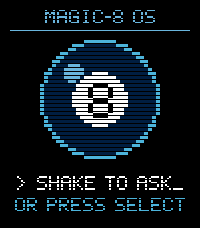
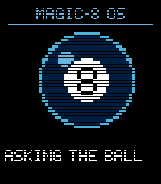
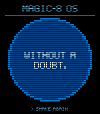

# pebbleMagic8

A retro Magic 8-Ball for the Pebble Time 2. Ask a question, flick your wrist (or
press Select), and the pixel-art 8-ball shakes, buzzes and lights up with its
answer in a blue-and-white retro style.

Built with Pebble Alloy (embedded JavaScript, powered by Moddable XS).

| Ready | Shaking | Answer |
|:---:|:---:|:---:|
|  |  |  |

## Building & running

```sh
pebble build                          # build for all targetPlatforms
pebble install --emulator emery       # install on the emery emulator
pebble install --phone <ip>           # install to a paired phone
```

## Target platforms

Alloy targets the modern Pebble hardware: **emery** (Pebble Time 2) and
**gabbro** (Pebble Round 2). Other platforms are currently not supported.

## Project layout

```
src/c/mdbl.c                   C glue around the Moddable runtime
src/embeddedjs/main.js         JavaScript that runs on the watch
src/embeddedjs/manifest.json   Moddable manifest
src/pkjs/index.js              PebbleKit JS (phone-side) code
package.json                   Project metadata (UUID, platforms, resources)
wscript                        Build rules — usually no need to edit
```

## Documentation

Full SDK docs and tutorials: <https://developer.repebble.com>
